# ⚡ PulseForge — Bare-Metal PWM Signal Generator (ARM Cortex-M4)

> **Hand-forged PWM: bare-metal Timer_A waveforms across every counting and output mode.**


Configures **Timer_A0** on the MSP432 directly through its registers to generate a **10 Hz, 50 % duty-cycle PWM** on **P2.5 (TA0.2)** from the 32.768 kHz **ACLK**, in six combinations of counting mode and output mode. The waveform is sampled back on P2.3 and plotted on the BoosterPack MKII LCD.

<p align="center">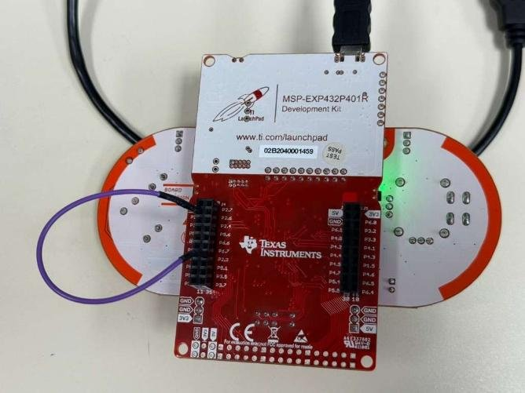 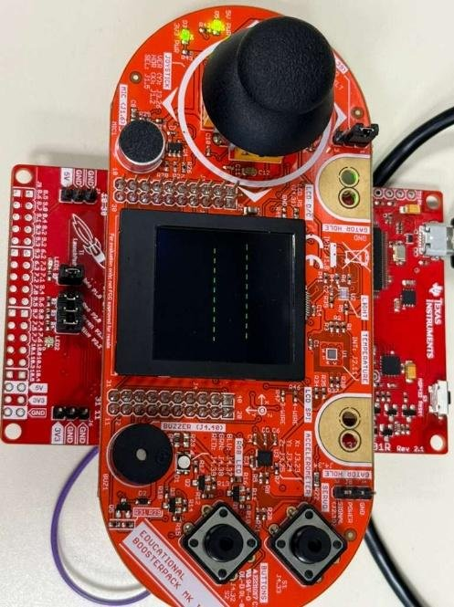</p>

## Hardware & Software

- TI **MSP-EXP432P401R** LaunchPad + **BOOSTXL-EDUMKII** (LCD)
- Jumper wire **P2.5 → P2.3**
- **Energia IDE** (direct register access via `msp.h`)

## Configurations

Select with `#define PWM_CONFIG` in `src/TimerA_PWM/TimerA_PWM.ino`. `COUNT = 32768/5`, `COUNT2 = COUNT/2`.

| `PWM_CONFIG` | Counting mode (MC) | Output mode (OUTMOD) | CCR0 | CCR2 |
|---|---|---|---|---|
| 1 | Up `0b01` | 2 – Toggle/Reset | COUNT/2 | COUNT2/2 |
| 2 | Up/Down `0b11` | 2 – Toggle/Reset | COUNT/4 | COUNT2/4 |
| 3 | Up | 4 – Toggle | COUNT/4 | COUNT2/4 |
| 4 | Up/Down | 4 – Toggle | COUNT/4 | COUNT2/4 |
| 5 | Up | 7 – Reset/Set | COUNT/2 | COUNT2/2 |
| 6 | Up/Down | 7 – Reset/Set | COUNT/4 | 0 |

**Why the values change:** in Up mode the timer counts 0 → CCR0, so CCR0 sets the period and CCR2 ≈ CCR0/2 gives 50 % duty. In Up/Down mode it counts 0 → CCR0 → 0, doubling the period, so the values are halved again to keep 10 Hz. Toggle mode (4) toggles once per period, so the output period is twice the timer period.

## Register Setup (excerpt)

```c
WDT_A->CTL = WDT_A_CTL_PW | WDT_A_CTL_HOLD;   // stop watchdog
TIMER_A0->CTL     = (TA_MODE | ACLK);         // ACLK, Up or Up/Down
TIMER_A0->CCR[0]  = CCR0_VAL;                 // period
P2->DIR = BIT5; P2->SEL0 |= BIT5; P2->SEL1 &= ~BIT5;   // P2.5 = TA0.2
TIMER_A0->CCTL[2] = OUTMOD;                   // output mode
TIMER_A0->CCR[2]  = CCR2_VAL;                 // duty threshold
```

## Build & Run

1. Mount the BoosterPack MKII and add a jumper from **P2.5** to **P2.3**.
2. Open `src/TimerA_PWM/TimerA_PWM.ino` in Energia, set `PWM_CONFIG` (1–6), upload.
3. Press **S2 (P1.4)**: the sketch samples P2.3 every 10 ms for 1 s and draws the waveform on the LCD.

## Results – LCD captures

| | | | |
|---|---|---|---|
| 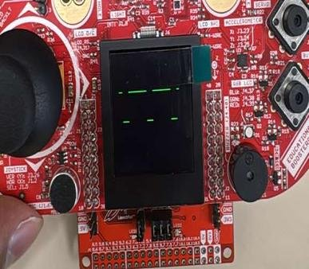 | 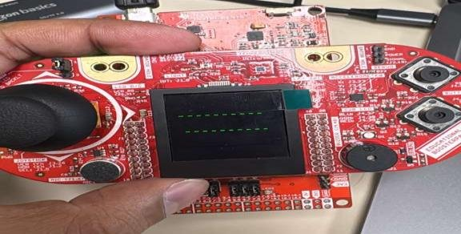 | 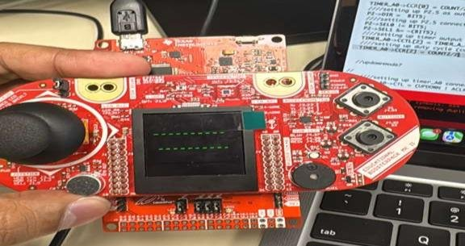 | 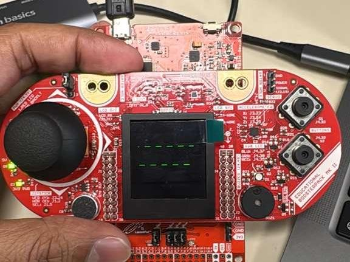 |
| 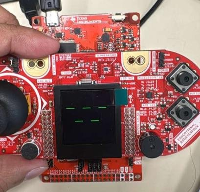 | 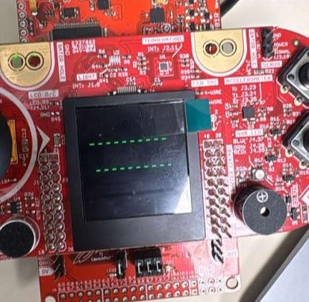 | 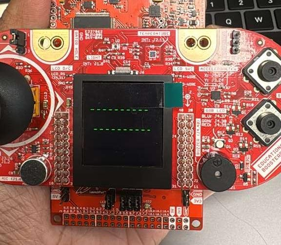 | 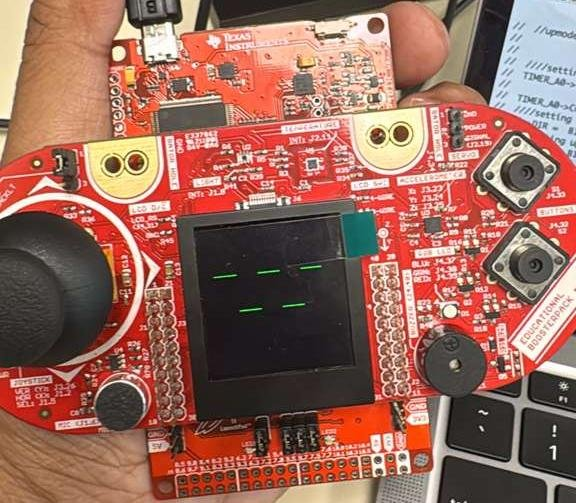 |
| 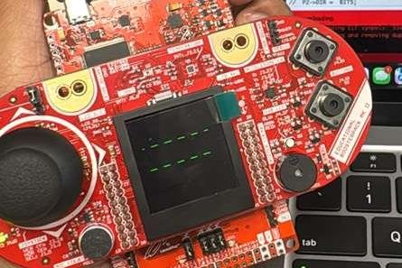 | 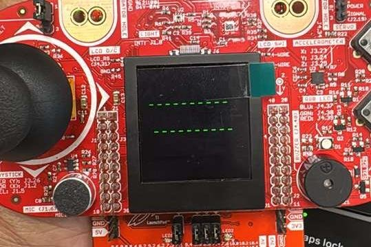 | 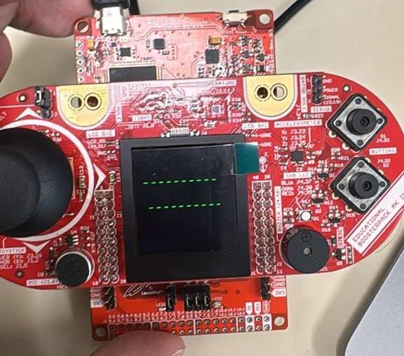 | 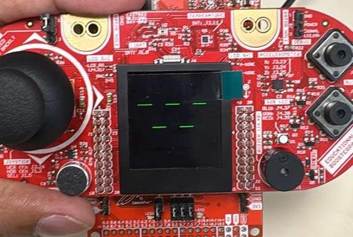 |

Waveforms sampled from P2.3 across the six counting/output-mode configurations, all tuned to 10 Hz at 50 % duty.

## Concepts Covered

- MSP432 clock system: ACLK / MCLK / SMCLK and their sources (LFXT, DCO, VLO, REFO)
- Timer_A counting modes and the 8 OUTMOD output modes
- Computing CCRx thresholds for a target frequency and duty cycle
- PWM applications: motor drive, power regulation, analog control

## Credits

The LCD waveform-sampling routine is based on the `msp432_timer_PWM` Energia example.

## Author

- **Aryan Verma**
